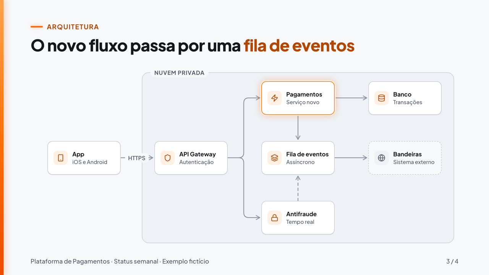

# Palco

Apresentações em HTML, vídeos MP4 e slides únicos em PNG gerados a partir de um roteiro em JSON. Você descreve o conteúdo (números, arquitetura, marcos) e o Palco cuida do layout, da animação e do acabamento, com a mesma régua de qualidade nos três formatos.

| Formato | O que sai | Para quê |
|---|---|---|
| **Apresentação** | `deck.html`, um arquivo só, que abre offline em qualquer navegador | Reunião, Teams, projetor, PDF para enviar |
| **Vídeo** | `video.mp4` 1920×1080, 60 fps, com transição neon e trilha opcional | Resumo semanal, explicação gravada, abertura de evento |
| **Slide único** | `slide-NN.png` 1920×1080 ou 3840×2160 | Anexo de e-mail, post interno, imagem para outra apresentação |

Componentes disponíveis: **capa**, **indicadores** (com variação e meta), **diagrama de arquitetura** (com fluxo animado) e **linha do tempo** (com status dos marcos).



---

## Sumário

1. [Instalação](#instalação)
2. [Primeiros passos em 2 minutos](#primeiros-passos-em-2-minutos)
3. [Fluxo de trabalho](#fluxo-de-trabalho)
4. [Escrevendo o `deck.json`](#escrevendo-o-deckjson)
5. [Apresentar](#apresentar)
6. [Exportar PDF](#exportar-pdf)
7. [Gerar vídeo](#gerar-vídeo)
8. [Gerar slide único (PNG)](#gerar-slide-único-png)
9. [Conferir antes de entregar](#conferir-antes-de-entregar)
10. [Usar com o Claude Code](#usar-com-o-claude-code)
11. [Temas e marca](#temas-e-marca)
12. [Dados e confidencialidade](#dados-e-confidencialidade)
13. [Problemas comuns](#problemas-comuns)
14. [Estrutura do projeto](#estrutura-do-projeto)

---

## Instalação

**Para apresentações** só é preciso Node 22 ou mais recente. Nada mais é instalado.

```bash
node -v
```

**Para vídeo, PNG e conferência** também são necessários o ffmpeg e o Playwright (Chromium headless). A instalação é feita uma vez e é a única etapa que acessa a rede:

```bash
brew install ffmpeg
```

```bash
npm install && npx playwright install chromium
```

Depois disso, tudo roda offline: o deck abre de `file://`, sem CDN, sem fontes remotas e sem chamadas externas.

---

## Primeiros passos em 2 minutos

Gere o exemplo que vem no repositório (dados fictícios):

```bash
node build-deck.mjs exemplos/status-semanal/deck.json
```

```bash
open exemplos/status-semanal/deck.html
```

Use **→** para avançar e **P** para abrir a janela do apresentador. Para ver o mesmo deck como vídeo, sem renderizar nada:

```bash
open "exemplos/status-semanal/deck.html?play"
```

E para gerar o MP4 de verdade:

```bash
node render.mjs exemplos/status-semanal/deck.json --video
```

O arquivo sai em `exemplos/status-semanal/out/video.mp4`.

---

## Fluxo de trabalho

Cada trabalho real fica numa pasta própria dentro de `conteudo/`, que **nunca vai para o git**:

```bash
mkdir -p conteudo/2026-11-10-status-semana-45
```

1. **Escrever** `conteudo/2026-11-10-status-semana-45/deck.json` (próxima seção, ou peça ao Claude Code).
2. **Gerar e conferir:**

   ```bash
   node render.mjs conteudo/2026-11-10-status-semana-45/deck.json --check
   ```

   Esse comando também gera o `deck.html`. Abra `out/check/contact.png` para ver todos os slides de uma vez.
3. **Apresentar** com o `deck.html`, ou **exportar** vídeo e PNG.

Tudo o que é gerado fica ao lado do `deck.json`:

```
conteudo/2026-11-10-status-semana-45/
  deck.json            o roteiro (você escreve)
  deck.html            a apresentação (gerado)
  out/
    check/contact.png  folha de contato da conferência
    video-draft.mp4    rascunho do vídeo
    video.mp4          vídeo final
    audio.wav          trilha masterizada
    slide-03.png       slides únicos
```

Só para gerar o HTML, sem conferência:

```bash
node build-deck.mjs conteudo/2026-11-10-status-semana-45/deck.json
```

---

## Escrevendo o `deck.json`

Um deck é um título, um rodapé opcional e uma lista de slides. Cada slide tem um `type` e um `title`. A referência completa de campos está em [docs/deck-spec.md](docs/deck-spec.md).

```json
{
  "title": "Status semanal: semana 45",
  "footer": "Squad Checkout · Status semanal",
  "slides": [
    { "type": "title", "title": "Status da [[semana 45]]" }
  ]
}
```

**Regras de texto que o build valida:**

- `[[palavra]]` destaca em laranja. No máximo um destaque por título.
- Título com até 14 palavras (capa: 10). Escreva a **conclusão**, não o assunto: "A latência caiu 15%" em vez de "Latência".
- `kicker` é o rótulo curto acima do título (ex.: "Arquitetura").
- `notes` são as notas do apresentador. Elas só aparecem na janela do apresentador, nunca no slide.

### Capa (`title`)

```json
{
  "type": "title",
  "kicker": "Status semanal · Semana 45",
  "title": "Plataforma de [[Pagamentos]]",
  "subtitle": "Números da semana, arquitetura do novo fluxo e próximos marcos.",
  "meta": "4 a 10 nov de 2026 · Squad Checkout",
  "notes": "Abrir com o contexto da semana."
}
```

Serve também como abertura de seção no meio do deck.

### Indicadores (`kpi`)

De 1 a 6 cartões. Até 4 ficam numa linha só; 5 ou 6 se dividem em duas linhas de 3.

```json
{
  "type": "kpi",
  "kicker": "Números da semana",
  "title": "Volume subiu e a [[latência]] caiu",
  "compareLabel": "vs. semana 44",
  "items": [
    { "label": "Transações", "value": 1284530, "prev": 1198220 },
    { "label": "Disponibilidade", "value": 99.97, "prev": 99.91, "goal": 99.95, "format": "pct", "decimals": 2 },
    { "label": "Latência p95", "value": 182, "prev": 214, "goal": 200, "better": "down", "format": "ms" },
    { "label": "Volume processado", "value": 4718250000, "prev": 4391200000, "format": "brl", "compact": true }
  ],
  "source": "Fonte: painel de observabilidade, semana 45."
}
```

| Campo | Efeito |
|---|---|
| `format` | `int` (padrão) → `1.284.530` · `decimal` → `3,4` · `pct` → `99,97%` · `ms` → `182 ms` · `brl` → `R$ 47.182.500,00` |
| `compact: true` | Abrevia `int` e `brl`: `1,3 mi`, `R$ 47,2 mi` |
| `brl` | **O valor vai em centavos inteiros**: `4718250000` = R$ 47.182.500,00 |
| `prev` | Mostra a variação com seta (`+7,2%`; em `pct`, em pontos percentuais: `+0,06 p.p.`). O contador anima do valor anterior até o atual |
| `better: "down"` | Para métricas em que cair é bom (latência, erros, custo). Define a cor e o "melhor/pior" da variação |
| `goal` | Mostra "Meta X · atingida" ou "não atingida", com ícone |

A variação sempre aparece com seta e sinal, além da cor. Dá para ler em preto e branco ou por quem não distingue cores.

### Diagrama de arquitetura (`diagram`)

Os componentes ficam numa grade de `cols` × `rows` (até 6×4). A posição é `at: [coluna, linha]`, contando a partir de 0, da esquerda para a direita e de cima para baixo.

```json
{
  "type": "diagram",
  "kicker": "Arquitetura",
  "title": "O novo fluxo passa por uma [[fila de eventos]]",
  "cols": 4,
  "rows": 3,
  "groups": [{ "label": "Nuvem privada", "from": [1, 0], "to": [3, 2] }],
  "nodes": [
    { "id": "app", "label": "App", "sub": "iOS e Android", "icon": "smartphone", "at": [0, 1] },
    { "id": "gw", "label": "API Gateway", "sub": "Autenticação", "icon": "shield", "at": [1, 1] },
    { "id": "pay", "label": "Pagamentos", "sub": "Serviço novo", "icon": "zap", "at": [2, 0], "highlight": true },
    { "id": "queue", "label": "Fila de eventos", "sub": "Assíncrono", "icon": "layers", "at": [2, 1] },
    { "id": "db", "label": "Banco", "sub": "Transações", "icon": "database", "at": [3, 0] },
    { "id": "ext", "label": "Bandeiras", "sub": "Sistema externo", "icon": "globe", "at": [3, 1], "kind": "external" }
  ],
  "edges": [
    { "from": "app", "to": "gw", "label": "HTTPS", "flow": true },
    { "from": "gw", "to": "pay", "flow": true },
    { "from": "pay", "to": "db" },
    { "from": "pay", "to": "queue" },
    { "from": "queue", "to": "ext", "style": "dashed", "flow": true }
  ]
}
```

Na grade, as posições do exemplo ficam assim (o grupo "Nuvem privada" cobre as colunas 1 a 3):

| | col 0 | col 1 | col 2 | col 3 |
|---|---|---|---|---|
| **lin 0** | | | Pagamentos (destaque) | Banco |
| **lin 1** | App | API Gateway | Fila de eventos | Bandeiras (externo) |
| **lin 2** | | | | |

O resultado renderizado é a imagem do topo deste README.

| Campo | Efeito |
|---|---|
| `highlight: true` | Borda neon: o componente novo ou o foco da conversa |
| `kind: "external"` | Borda tracejada: sistema de terceiros |
| `flow: true` | Pacotes neon percorrem a conexão (a direção do dado) |
| `style: "dashed"` | Conexão tracejada (ex.: assíncrona) |
| `groups` | Caixa ao redor de células: VPC, domínio, nuvem, time |

Ícones disponíveis (em `lib/icons.js`): `smartphone`, `globe`, `shield`, `lock`, `server`, `database`, `layers`, `zap`, `users`, `message-square`, `clock`, `check`, `circle-check`, `triangle-alert`, `trending-up`, `trending-down`, `arrow-right`, `minus`, `chevron-left`, `chevron-right`. Para acrescentar um ícone, copie o conteúdo interno do `<svg>` de [lucide.dev](https://lucide.dev) para `lib/icons.js`.

**Dicas de layout:**

- Com rótulos nas conexões, prefira até 4 colunas: o rótulo precisa de espaço entre os nós.
- Conexões entre colunas vizinhas na mesma linha ficam retas; as outras fazem um cotovelo no meio.
- Evite que uma conexão atravesse outro nó. Se atravessar, mude o nó de célula.

### Linha do tempo (`timeline`)

De 2 a 6 marcos. A linha laranja de progresso vai até o último marco que não é `next`.

```json
{
  "type": "timeline",
  "kicker": "Evolução do projeto",
  "title": "Da descoberta ao [[piloto]] em cinco marcos",
  "items": [
    { "date": "Jun", "label": "Descoberta", "detail": "Mapa do fluxo atual e gargalos", "status": "done" },
    { "date": "Ago", "label": "MVP", "detail": "Serviço novo em homologação", "status": "done" },
    { "date": "Out", "label": "Migração", "detail": "30% do tráfego no fluxo novo", "status": "doing" },
    { "date": "Nov", "label": "Antifraude", "detail": "Depende da janela do time parceiro", "status": "risk" },
    { "date": "Dez", "label": "Piloto", "detail": "100% do tráfego", "status": "next" }
  ]
}
```

| `status` | Aparece como |
|---|---|
| `done` | ✓ Concluído |
| `doing` | Relógio · Em andamento (anel neon) |
| `risk` | Alerta · Em risco (âmbar) |
| `next` | Planejado (tracejado) |

`date` aceita qualquer texto curto: `"Ago"`, `"Q3"`, `"Sprint 12"`, `"15/11"`.

### Estrutura que costuma funcionar

| Tipo de reunião | Sequência |
|---|---|
| Status semanal para a liderança | capa → indicadores → linha do tempo → capa de fecho com o pedido |
| Apresentação de arquitetura | capa → diagrama atual → diagrama novo (com `highlight`) → linha do tempo da migração |
| Evolução do projeto | capa → linha do tempo → indicadores de resultado → próximos passos |

---

## Apresentar

Abra o `deck.html` em qualquer navegador (Chrome recomendado). Funciona sem internet e pode ir por e-mail, pendrive ou Teams.

| Tecla | Ação |
|---|---|
| → · espaço · Enter · PageDown | Avançar (o slide anima) |
| ← · Backspace · PageUp | Voltar (o slide aparece pronto) |
| F | Tela cheia |
| P | Janela do apresentador |
| R | Repetir a animação do slide atual |
| Home · End | Primeiro · último slide |

Clique na metade direita da tela para avançar e na esquerda para voltar. Passadores de slide (que enviam PageUp/PageDown) funcionam direto. No celular, deslize o dedo.

**Janela do apresentador (P):** mostra o número do slide, o cronômetro, as `notes` do slide atual, o título do próximo e botões Anterior/Próximo. Para usar com projetor: deixe o `deck.html` em tela cheia no projetor e a janela do apresentador no notebook. Se a janela não abrir, libere pop-ups para arquivos locais no navegador.

**Link direto para um slide:** `deck.html#3` abre no slide 3.

---

## Exportar PDF

1. Abra o `deck.html` no Chrome.
2. Imprimir (⌘P) → Destino: **Salvar como PDF**.
3. Em "Mais definições", ligue **Gráficos de plano de fundo**.

Sai um slide por página (1920×1080), cada um no estado final da animação.

---

## Gerar vídeo

O vídeo é a apresentação tocando sozinha. Cada slide entra com a própria animação e fica parado por alguns segundos (`hold`). Depois a faixa neon varre a tela e revela o próximo slide.

### Configuração no `deck.json`

No nível do deck, ao lado de `title` e `slides`:

```json
"video": { "music": "suave", "hold": 3 }
```

E, num slide que precisa de mais tempo de leitura, junto dos outros campos dele:

```json
"hold": 6
```

| Campo | Padrão | Efeito |
|---|---|---|
| `video.hold` | `3` | Segundos parado depois da animação de cada slide |
| `slides[i].hold` | — | Sobrepõe o `hold` num slide específico (ex.: indicadores com mais leitura) |
| `video.music` | `nenhuma` | `suave`: trilha de piano e mallet sintetizada em código, com um sopro em cada transição |
| `video.bpm` | `120` | Andamento da trilha. Com trilha, cada slide dura compassos inteiros e a troca cai no tempo forte |

Regra prática para o `hold`: 1 segundo para cada 3 palavras na tela, mais 2.

### Comandos

Prévia instantânea no navegador, sem renderizar:

```bash
open "conteudo/2026-11-10-status-semana-45/deck.html?play"
```

Rascunho rápido (960×540, 30 fps; cerca de 10 s para 30 s de vídeo):

```bash
node render.mjs conteudo/2026-11-10-status-semana-45/deck.json --video --draft
```

Final (1920×1080, 60 fps, motion blur; cerca de 2,5× a duração do vídeo):

```bash
node render.mjs conteudo/2026-11-10-status-semana-45/deck.json --video
```

| Opção | Efeito |
|---|---|
| `--draft` | Rascunho rápido em `out/video-draft.mp4` |
| `--mudo` | Sem trilha, mesmo com `music: "suave"` no deck |
| `--from 10 --to 15` | Só um trecho (segundos), para revisar um ponto |
| `--out caminho.mp4` | Outro nome de arquivo |
| `--workers 4` | Número de navegadores em paralelo (padrão: metade dos núcleos, até 6) |
| `--theme nome` | Outro tema |

Especificação do arquivo final: H.264 yuv420p, BT.709, CRF 16, AAC 256 kbps e loudness de −14 LUFS medido no próprio MP4 (o comando imprime o valor). Funciona em Teams, PowerPoint, YouTube, Slack e WhatsApp.

Para conferir:

```bash
ffprobe -v error -show_entries stream=codec_name,width,height,r_frame_rate -show_entries format=duration -of compact=p=0 conteudo/2026-11-10-status-semana-45/out/video.mp4
```

---

## Gerar slide único (PNG)

Todos os slides:

```bash
node render.mjs conteudo/2026-11-10-status-semana-45/deck.json --png
```

Só alguns slides, em alta resolução (3840×2160):

```bash
node render.mjs conteudo/2026-11-10-status-semana-45/deck.json --png --slides 2,3 --scale 2
```

Os arquivos saem em `out/slide-02.png`, `out/slide-03.png`, no estado final da animação. Num slide avulso, use o `footer` para dar contexto (time e data), porque o "2 / 4" do rodapé perde o sentido fora do deck.

---

## Conferir antes de entregar

```bash
node render.mjs conteudo/2026-11-10-status-semana-45/deck.json --check
```

Saída esperada:

```
slides: 4 · vídeo: 30.0 s
folha de contato: conteudo/2026-11-10-status-semana-45/out/check/contact.png
avisos de layout: nenhum
erros na página: nenhum
determinismo (T=6.30 s): ok a7bfafb8352c
```

- **Folha de contato:** uma linha por slide, com três colunas (0,5 s, 1,2 s e estado final). Mostra a animação e o resultado de uma vez.
- **Avisos de layout:** texto que não coube e teve de ser reduzido (ex.: `slide 3: rótulo do nó "Fila de eventos" não coube`). Encurte o texto em vez de aceitar o aviso.
- **Determinismo:** o mesmo instante renderizado duas vezes dá a mesma imagem. Se falhar, algum código usa tempo real ou `Math.random`.

O comando termina com código 1 se houver aviso, erro ou falha de determinismo. Dá para usar num script.

---

## Usar com o Claude Code

O repositório traz ordens de serviço para o agente. Abra o Claude Code na pasta do Palco e mande o pedido com o modelo do fim de cada arquivo:

| Arquivo | Para |
|---|---|
| [GERAR-APRESENTACAO.md](GERAR-APRESENTACAO.md) | Deck HTML a partir dos seus dados |
| [GERAR-VIDEO.md](GERAR-VIDEO.md) | MP4 a partir de um deck novo ou existente |
| [GERAR-SLIDE.md](GERAR-SLIDE.md) | PNG avulso |

Exemplo de pedido:

```text
Siga GERAR-APRESENTACAO.md.

Tema: status semanal da Plataforma de Pagamentos para a liderança
Mensagem principal: a migração avançou e a latência caiu; o antifraude está em risco
Dados: transações 1.284.530 (semana anterior 1.198.220); disponibilidade 99,97% (99,91%, meta 99,95%);
       latência p95 182 ms (214 ms, meta 200 ms)
Arquitetura: app → API Gateway → serviço de Pagamentos (novo) → banco; Pagamentos → fila → bandeiras
Marcos: descoberta (jun, feito), MVP (ago, feito), migração (out, em andamento), antifraude (nov, em risco),
        piloto (dez, planejado)
Pedido final: priorizar a janela de mudança de novembro com o time parceiro
Tema visual: claro
```

O agente escreve o roteiro, gera, roda o `--check`, olha a folha de contato, critica (nota mínima 8 em cada critério) e corrige antes de entregar. As regras que ele segue estão no [CLAUDE.md](CLAUDE.md).

Para ajustar depois, peça em linguagem natural: *"no slide 2, troque o título para 'A meta de disponibilidade foi batida' e aumente o hold para 6 s"*.

---

## Temas e marca

O tema padrão é o `claro`: fundo claro (lê bem em projetor e no PDF), texto grafite e uma faixa neon laranja como assinatura. O brilho fica só na faixa, nos traços e no fluxo; nunca no texto.

Um tema é um JSON com as cores e a fonte ([themes/claro.json](themes/claro.json)). Para criar o tema de uma empresa:

1. Copie `themes/claro.json` para `themes/local/minha-empresa.json`. A pasta `themes/local/` fica fora do git.
2. Troque as cores pelas do brandbook oficial. O `accent-strong` é usado em texto: mantenha contraste de pelo menos 4,5:1 com o fundo.
3. Se a empresa tem fonte própria, coloque os `.woff2` em `themes/local/` e aponte em `font.files`, respeitando a licença da fonte.
4. Use com `"theme": "minha-empresa"` no deck ou `--theme minha-empresa` na linha de comando.

O build valida o tema e avisa quando falta uma cor ou um arquivo de fonte.

---

## Dados e confidencialidade

- **O repositório guarda só o motor, os temas neutros e os exemplos fictícios.** Trabalho real vai em `conteudo/`, e marca de empresa em `themes/local/`. As duas pastas estão no `.gitignore`.
- O deck gerado é autossuficiente: não carrega nada da internet e não envia nada para fora. Pode ser aberto numa rede fechada.
- Os números do slide vêm só dos dados que você fornece. Para exemplo ilustrativo, escreva "Dados fictícios" no campo `source` ou no `footer`.
- **Ao usar com o Claude Code, todo o conteúdo que o agente lê é enviado para a API do modelo.** Com dados internos de empresa, use só se o uso de IA estiver aprovado pela empresa.

---

## Problemas comuns

| O que aparece | O que fazer |
|---|---|
| `slides[2].nodes[1].at: [coluna, linha] dentro da grade 4×3 (começa em 0)` | A posição passou da grade. Lembre que a primeira coluna é 0 |
| `slides[1].items[0].value: em brl o valor é em centavos inteiros` | Multiplique por 100 e tire a vírgula: R$ 47,50 → `4750` |
| `slides[0].title: 16 palavras; corte para no máximo 14` | Encurte o título; o resto vai para o `subtitle` |
| `slides[2].nodes[0].icon: "cloud" não existe em lib/icons.js` | Use um ícone da lista ou acrescente o SVG em `lib/icons.js` |
| `tema "x" não encontrado em themes/ nem em themes/local/` | Confira o nome do arquivo (sem `.json`) |
| Aviso `... não coube` no `--check` | Texto longo demais para o espaço: encurte |
| `Cannot find package 'playwright'` | Rode `npm install && npx playwright install chromium` |
| `spawn ffmpeg ENOENT` | Instale o ffmpeg (`brew install ffmpeg`) |
| A janela do apresentador não abre | Libere pop-ups para arquivos locais no navegador |
| O PDF sai sem cores de fundo | Ligue "Gráficos de plano de fundo" na impressão |

---

## Estrutura do projeto

```
build-deck.mjs          gera o deck.html: valida o deck.json e embute fontes, estilos e script
render.mjs              vídeo (--video), PNG (--png) e conferência (--check), via Playwright + ffmpeg
lib/
  runtime.js            navegação, apresentador, timeline do vídeo; contrato seek(i, t) e frame(T)
  components/           title, kpi, diagram, timeline (+ header comum)
  motion.js             molas em forma fechada (toda animação é função pura do tempo)
  format.js             números em pt-BR, variação e meta
  validate.mjs          validação do deck.json e do tema
  icons.js              ícones Lucide embutidos
  audio/                trilha sintetizada (score.mjs) e master de loudness (master.mjs)
  deck.css              layout e estilos dos slides
themes/claro.json       tema padrão (themes/local/ fica fora do git)
fonts/                  Plus Jakarta Sans (OFL 1.1)
exemplos/               decks fictícios
conteudo/               trabalho real (fora do git)
CLAUDE.md               regras do estúdio (visual, movimento, crítica)
GERAR-*.md              ordens de serviço para o agente
docs/deck-spec.md       referência de todos os campos do deck.json
docs/fases.md           roadmap, pendências e dependências
```

### Como funciona por dentro

Cada slide é uma **função pura do tempo**: `palco.seek(i, t)` desenha o slide `i` no instante `t`. Ao vivo, o navegador chama essa função a cada quadro. No vídeo, o `render.mjs` a chama quadro a quadro e entrega as imagens ao ffmpeg. Por isso a apresentação, o vídeo e o PNG saem idênticos, e o mesmo render sempre dá o mesmo resultado.

As animações usam molas físicas (sem curvas de easing fixas), e cada tipo de elemento entra de um jeito: máscara por palavra no título, traço que se desenha nas conexões, contador nos números, crescimento a partir do centro nos nós.

---

## Roadmap

Fases 1 (apresentação) e 2 (vídeo e PNG) prontas. Próximas: vídeo com a sua voz (transcrição local, troca de slides no ritmo da fala e legenda) e tema de empresa. Detalhes em [docs/fases.md](docs/fases.md).
